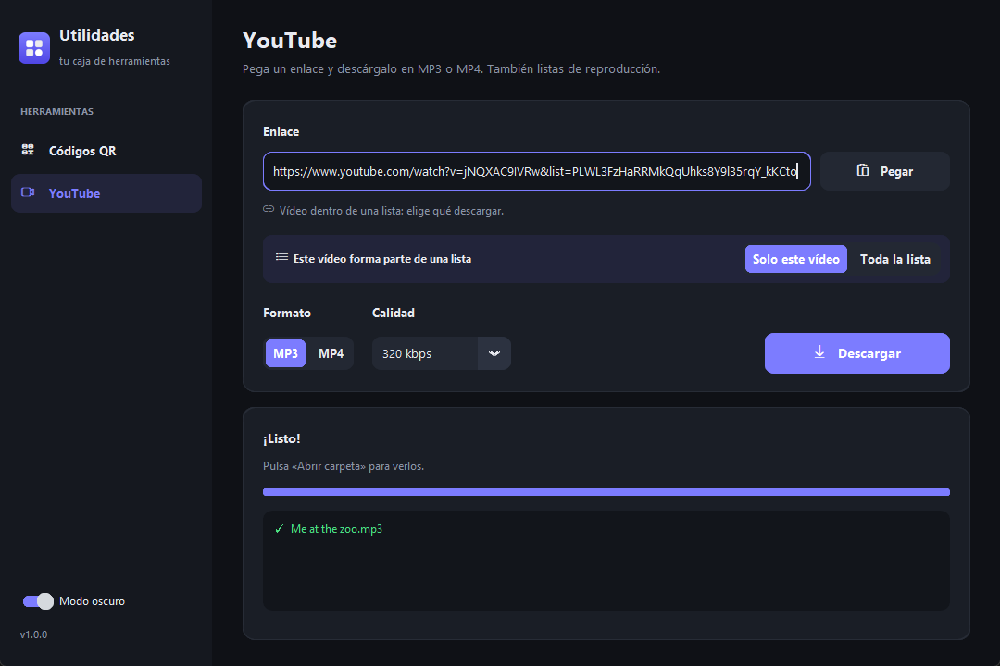
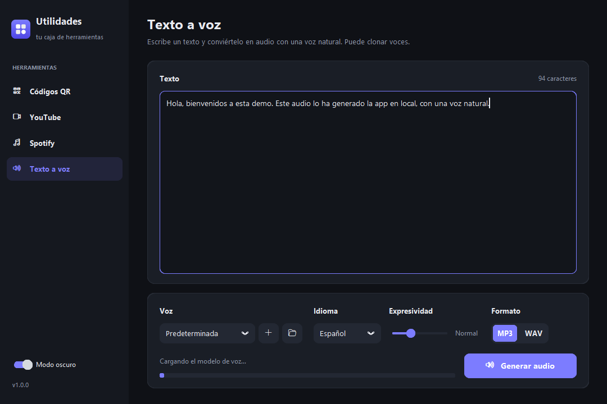
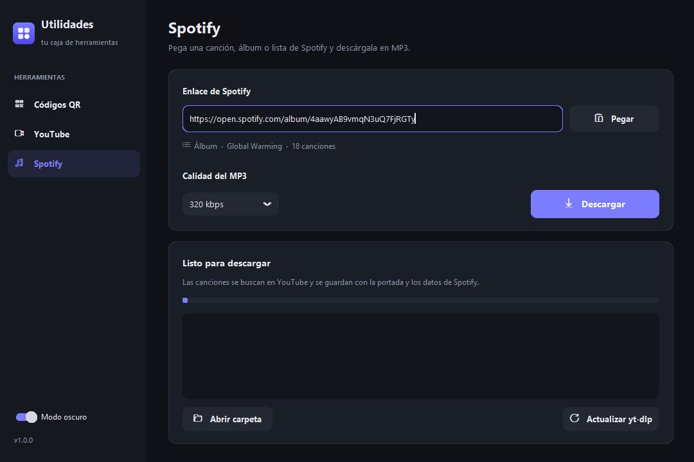
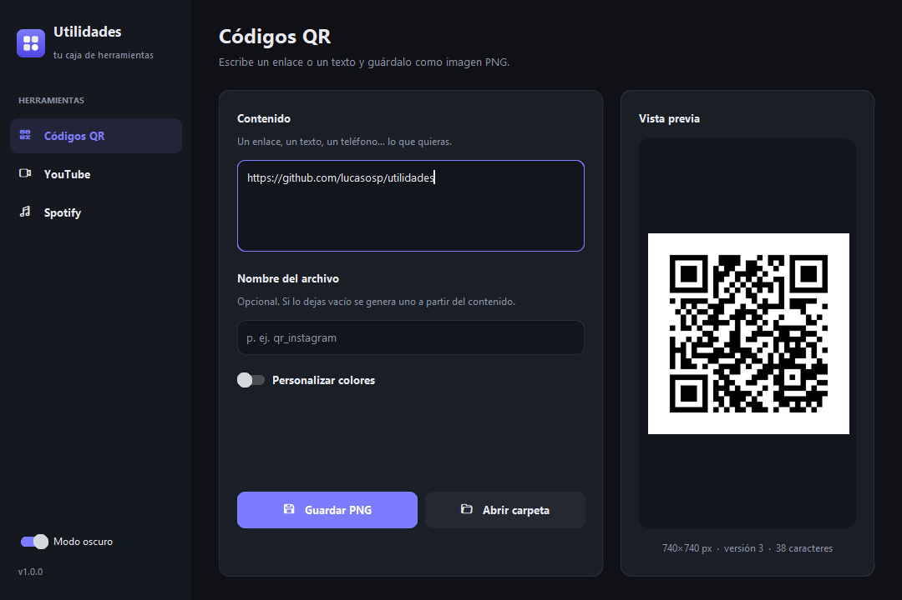

<p align="center">
  
</p>

<h1 align="center">Utilidades</h1>

<p align="center">
  Una caja de herramientas de escritorio para el día a día: rápida, bonita y fácil de ampliar.<br>
  Por ahora incluye un <b>generador de códigos QR</b> y descargadores de <b>YouTube</b> (MP3 / MP4) y <b>Spotify</b> (MP3), y un <b>texto a voz</b> local con voces naturales y clonación de voz.
</p>

<p align="center">
  
  
  
  
</p>

---

## Qué hace

### Códigos QR
- Vista previa **en directo** mientras escribes.
- Por defecto, negro sobre blanco de toda la vida. Si activas **Personalizar colores** puedes elegir el color del código y del fondo (selector de color o código hex) o dejar el **fondo transparente**. Te avisa si el contraste es tan bajo que el móvil puede no leerlo.
- Se guardan como PNG de alta resolución en la carpeta `generados/`.
- El nombre del archivo se genera solo a partir del contenido (o pon el tuyo).

### YouTube
- Descarga en **MP3** (con portada y metadatos) o en **MP4** (H.264 + AAC, se reproduce en cualquier sitio).
- Eliges la calidad: 320/192/128 kbps o Máxima/1080p/720p/480p/360p.
- **Listas de reproducción**: si el enlace es un vídeo dentro de una lista, eliges si quieres *solo ese vídeo* o *la lista entera*. Las listas se guardan en su propia subcarpeta y numeradas.
- Progreso, velocidad y tiempo restante; puedes cancelar en cualquier momento (se limpian los archivos a medias).
- Si copias un enlace antes de abrir la pestaña, se pega solo.
- Los archivos se guardan en la carpeta `descargas/`.

### Spotify
- Pega el enlace de una **canción**, un **álbum** o una **lista** pública y se descarga en MP3.
- El MP3 lleva el título, los artistas, el álbum, el número de pista, el año y la **portada de Spotify**.
- No hace falta cuenta ni claves de API.
- Si una descarga se corta, vuelve a darle: las canciones que ya tienes se saltan.

> **¿Cómo funciona?** El audio de Spotify está protegido (DRM) y no se puede descargar tal cual. La app lee los datos públicos de Spotify, busca cada canción en YouTube (elige la versión cuya duración coincide con la de Spotify y descarta directos, covers, remixes…) y la etiqueta con la información de Spotify. Es el mismo método que usa [spotDL](https://github.com/spotDL/spotify-downloader).
>
> Sin iniciar sesión, Spotify solo enseña las **primeras 100 canciones** de una lista.

### Texto a voz
- Escribes un texto y te da un **MP3 o WAV** leído con una voz natural, nada robótica.
- Funciona **en tu ordenador**, sin internet ni cuentas, con [Chatterbox](https://github.com/resemble-ai/chatterbox) (licencia MIT): el texto no sale de tu PC.
- **Clonación de voz**: añade un audio de 10-20 segundos de alguien hablando (vale una nota de voz) y la app lee el texto con esa voz.
- 15 idiomas (español, inglés, francés, italiano, portugués, alemán…) y un control de **expresividad** para que suene más neutra o más intensa.
- Los textos largos se parten en frases solas y se unen con pausas naturales.
- Se guardan en `generados/voz/` y las voces que añades, en `voces/`.

> **Instalación aparte.** El motor necesita PyTorch y el modelo (unos 6 GB con tarjeta NVIDIA, 4 GB sin ella). No se instala con la app: la primera vez que abras la pestaña te ofrece instalarlo con un botón. Va en su propio entorno (`.venv-voz`, con el modelo en `.modelos`); para quitarlo, borra esas dos carpetas.
>
> Con tarjeta NVIDIA cada frase sale en pocos segundos. Sin ella también funciona, pero bastante más lento.
>
> Chatterbox añade a cada audio una marca de agua inaudible ([Perth](https://github.com/resemble-ai/perth)) que permite identificarlo como voz generada. **Clona solo tu voz o la de alguien que te haya dado permiso.**

Además: modo claro/oscuro, recuerda tus últimas opciones y atajos <kbd>Ctrl</kbd>+<kbd>1</kbd>, <kbd>Ctrl</kbd>+<kbd>2</kbd>, <kbd>Ctrl</kbd>+<kbd>3</kbd>… para cambiar de herramienta.

## Instalación (Windows)

1. Instala **[Python 3.10 o superior](https://www.python.org/downloads/)** marcando la casilla *“Add python.exe to PATH”*.
2. Descarga este repositorio (botón verde *Code → Download ZIP*) o clónalo:
   ```bash
   git clone https://github.com/lucasosp/utilidades.git
   ```
3. Haz doble clic en **`iniciar.bat`**.

La primera vez tarda un minuto porque crea un entorno virtual (`.venv`) e instala las dependencias. A partir de ahí se abre al momento.

### Acceso directo y barra de tareas

Ejecuta **`crear_acceso_directo.bat`** una vez: crea un acceso directo *Utilidades* en el escritorio y en el menú Inicio (así también la encuentras escribiendo "Utilidades" en el buscador de Windows).

Para anclarla a la barra de tareas, abre la app, haz clic derecho en su icono de la barra y elige **Anclar a la barra de tareas**. Se guarda con su propio icono y se abre aunque reinicies el PC.

> Si la anclaste con una versión anterior y te sale el icono de Python o una terminal, desánclala y vuelve a anclarla así.

### ffmpeg
Para convertir a MP3 y unir audio y vídeo hace falta **ffmpeg**. Si ya lo tienes instalado se usa ese; si no, la app usa el que viene con el paquete `imageio-ffmpeg`, así que no tienes que hacer nada.

### Otros sistemas
También funciona en macOS y Linux (necesitas Python con Tkinter):
```bash
python -m venv .venv
source .venv/bin/activate
pip install -r requirements.txt
python Utilidades.pyw
```

## Desde la consola (y desde Claude Code)

Todo lo que hace la app se puede hacer con el comando `utilidades`. Para tenerlo en cualquier terminal, ejecuta una vez (después de haber abierto la app con `iniciar.bat`):

```bash
.venv\Scripts\python.exe cli.py instalar-comando
```

Crea el comando en `~/.local/bin` (y añade esa carpeta al PATH si hace falta). Abre una terminal nueva y ya puedes usarlo:

```bash
utilidades qr "https://ejemplo.com" -o qr.png
utilidades youtube URL --formato mp4 --calidad 1080 -o videos
utilidades youtube URL --lista                       # lista de reproducción entera
utilidades spotify https://open.spotify.com/album/… -o musica
utilidades voz "Hola, bienvenidos" -o intro.mp3
utilidades voz "Frase uno." "Frase dos." -o clips/  # varios audios en una sola carga del modelo
utilidades voz --archivo guion.txt --voz "Mi voz" -i es -e 0.7 -o narracion.mp3
utilidades voces --anadir nota_de_voz.m4a --nombre "Mi voz"
utilidades info                                     # rutas, voces y estado
utilidades --help                                   # todas las opciones
```

Añade `--json` y la última línea será un JSON con las rutas de los archivos creados: ideal para scripts.

### Skill para Claude Code

```bash
utilidades instalar-skill
```

Copia [`skill/SKILL.md`](skill/SKILL.md) a `~/.claude/skills/utilidades/`, así Claude Code sabe usar estas herramientas en **cualquier proyecto**. A partir de ahí basta con pedírselo con tus palabras:

> *Descárgame en MP3 este vídeo: …*
>
> *Hazme un vídeo de 20 segundos con la música de este vídeo de YouTube, que salga un QR a mi web y una voz en off que diga: …*

La skill le explica los comandos, cómo leer los resultados y cómo montar las piezas con ffmpeg (QR encima del vídeo, música que baja cuando habla la voz, etc.).

## Si YouTube deja de funcionar

YouTube cambia a menudo y [yt-dlp](https://github.com/yt-dlp/yt-dlp) se actualiza para seguirle el ritmo. Si una descarga falla, pulsa **“Actualizar yt-dlp”** en la pestaña de YouTube o Spotify y reinicia la app.

Para algunos formatos YouTube exige un intérprete de JavaScript. Si ves errores de formatos no disponibles, instala [Deno](https://deno.com/) (`winget install DenoLand.Deno`) o Node.js; la app los detecta solos.

## Estructura del proyecto

```
utilidades/
├── iniciar.bat                 # prepara el entorno (la 1.ª vez) y abre la app
├── Utilidades.pyw              # abre la app sin consola (lo usan los accesos directos)
├── cli.py                      # entrada del comando de consola `utilidades`
├── crear_acceso_directo.bat    # accesos directos en el escritorio y en el menú Inicio
├── requirements.txt
├── assets/                     # icono y capturas
├── generados/                  # QR y, en generados/voz, los audios de texto a voz
├── descargas/                  # vídeos y canciones descargados
├── voces/                      # voces añadidas para clonar (no se suben a git)
├── skill/SKILL.md              # skill de Claude Code (utilidades instalar-skill)
└── utilidades/                 # código fuente
    ├── app.py                  # ventana principal y menú lateral
    ├── cli.py                  # comandos de consola
    ├── comando.py              # instala el comando global y la skill
    ├── config.py               # rutas y ajustes guardados
    ├── ui.py                   # colores, fuentes y widgets comunes
    ├── windows.py              # icono en la barra de tareas y accesos directos
    ├── voz/
    │   ├── motor.py            # instala el motor de voz y habla con el trabajador
    │   └── trabajador.py       # proceso aparte (en .venv-voz) que genera la voz
    └── herramientas/
        ├── registro.py         # lista de herramientas del menú
        ├── base.py             # clase base Herramienta
        ├── qr.py               # interfaz del QR
        ├── qr_motor.py         # generación de QR (sin interfaz)
        ├── descarga_base.py    # hilo de descarga común (cancelar, limpiar, ffmpeg)
        ├── panel_descarga.py   # tarjeta de progreso común
        ├── youtube.py          # interfaz de YouTube
        ├── youtube_motor.py    # lógica de YouTube (yt-dlp)
        ├── spotify.py          # interfaz de Spotify
        ├── spotify_motor.py    # lectura de Spotify + búsqueda en YouTube + etiquetas
        └── voz.py              # interfaz de texto a voz
```

## Añadir una herramienta nueva

1. Crea `utilidades/herramientas/mi_herramienta.py`:
   ```python
   from .. import ui
   from .base import Herramienta

   class MiHerramienta(Herramienta):
       id = "mia"
       nombre = "Mi herramienta"
       descripcion = "Lo que hace, en una línea."
       icono = "enlace"  # cualquier clave de ui.ICONOS

       def __init__(self, master, app):
           super().__init__(master, app)
           tarjeta = ui.Tarjeta(self)
           tarjeta.pack(fill="both", expand=True)
           ui.Etiqueta(tarjeta, "¡Hola!", 16, "bold").pack(padx=22, pady=20)
   ```
2. Añádela a la lista `HERRAMIENTAS` en `utilidades/herramientas/registro.py`.
3. Si quieres usarla también desde la consola, pon la lógica en un módulo sin interfaz (como `qr_motor.py`) y añade un subcomando en `utilidades/cli.py`.

Aparecerá sola en el menú lateral.

## Aviso

Descarga solo contenido que tengas derecho a descargar y respeta los términos de servicio de cada plataforma y los derechos de autor. No uses la clonación de voz para hacerte pasar por nadie.

## Créditos

Hecho con [CustomTkinter](https://github.com/TomSchimansky/CustomTkinter), [yt-dlp](https://github.com/yt-dlp/yt-dlp), [qrcode](https://github.com/lincolnloop/python-qrcode), [Pillow](https://python-pillow.org/), [Mutagen](https://github.com/quodlibet/mutagen) y [Chatterbox](https://github.com/resemble-ai/chatterbox).
